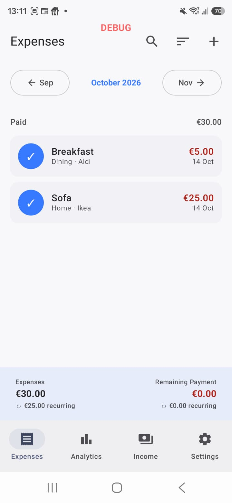
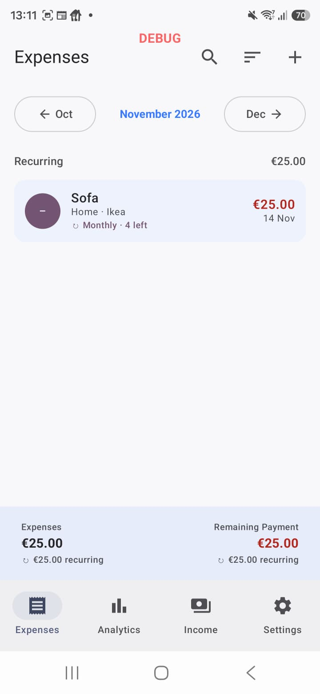
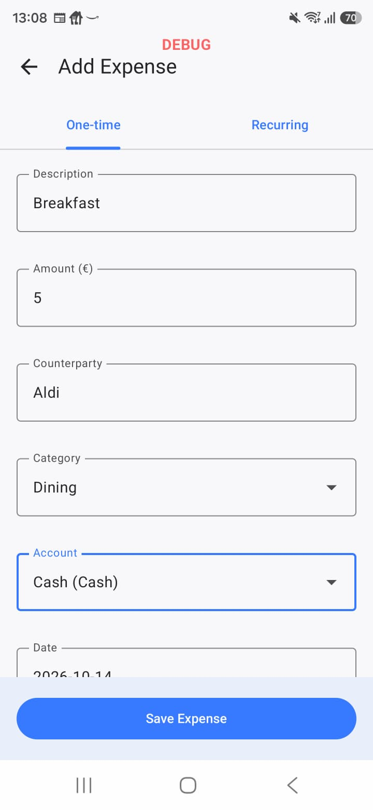
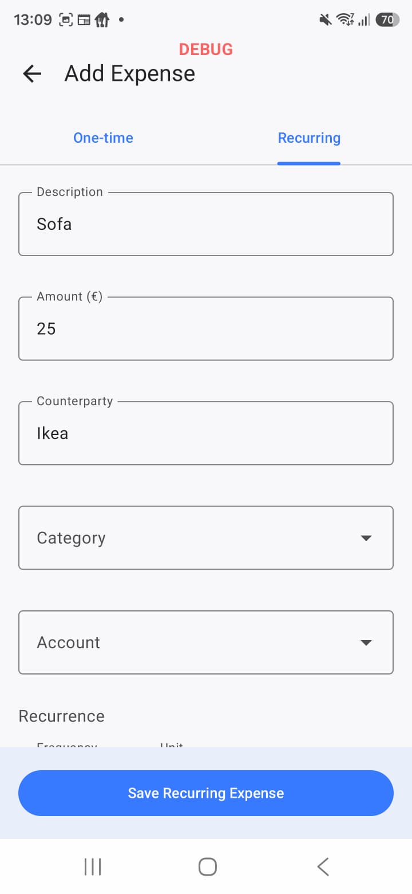
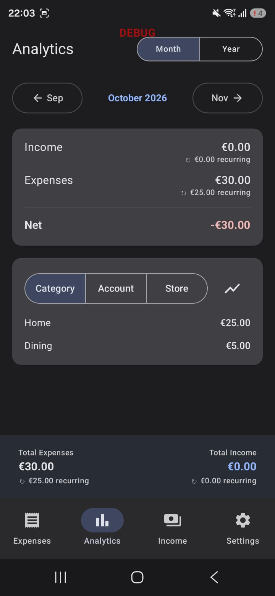
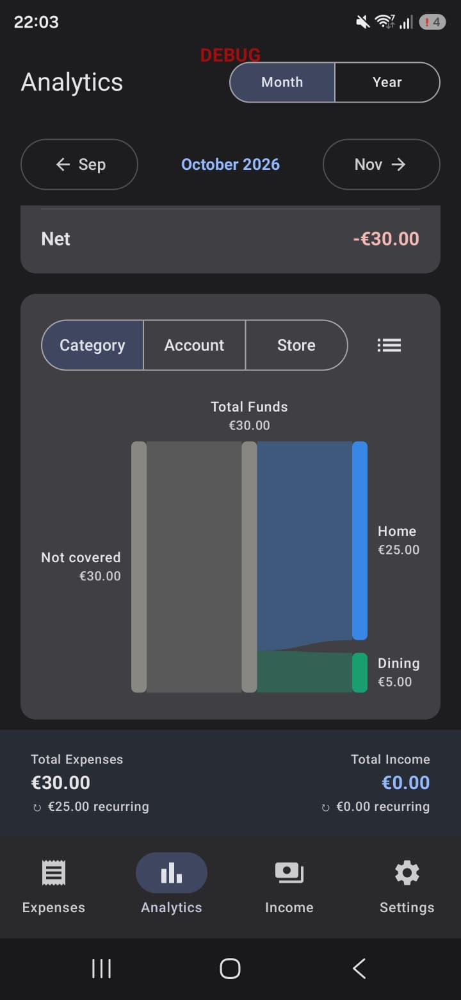

# ExpenseLens

An Android expense tracker built with modern Android tooling.

## Features
- Track income & expenses across multiple **accounts**
- Organize spending with **categories** and **counterparties**
- **Recurring transactions** generated from templates
- **Analytics** dashboard with spending breakdowns (including a Sankey view)
- Offline-first local storage

## Tech stack
- **Kotlin** + **Jetpack Compose** (UI)
- **Room** for persistence, with schema migrations
- MVVM architecture (`ViewModel` + repository)
- Instrumented tests (including a data-migration test)

## Build & run
```bash
./gradlew assembleDebug
```
Or open the project in Android Studio and run the `app` configuration.

## Screenshots
| Expenses | Upcoming recurring | Add expense |
|:---:|:---:|:---:|
|  |  |  |

| Recurring expense | Analytics | Sankey cash flow |
|:---:|:---:|:---:|
|  |  |  |
